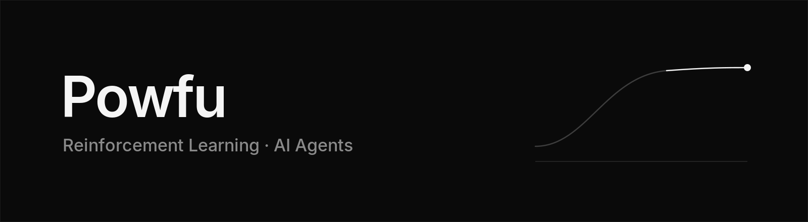
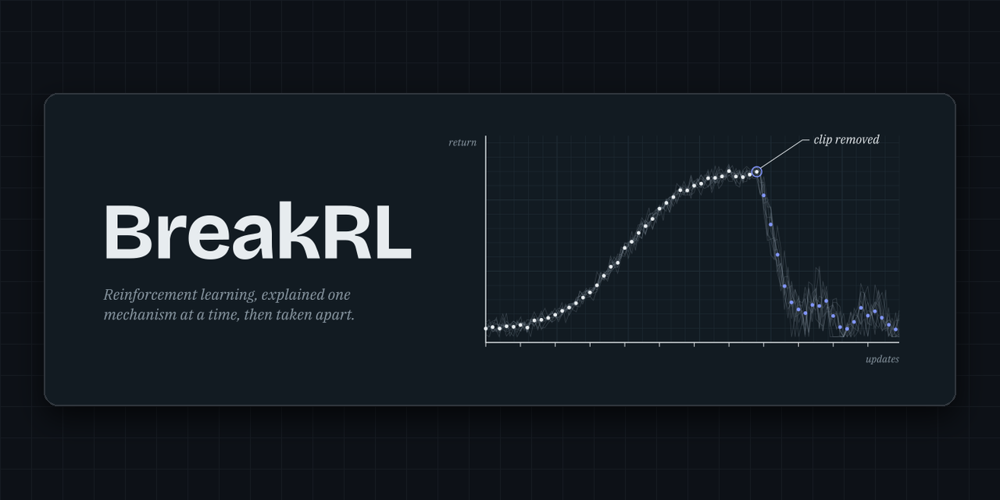
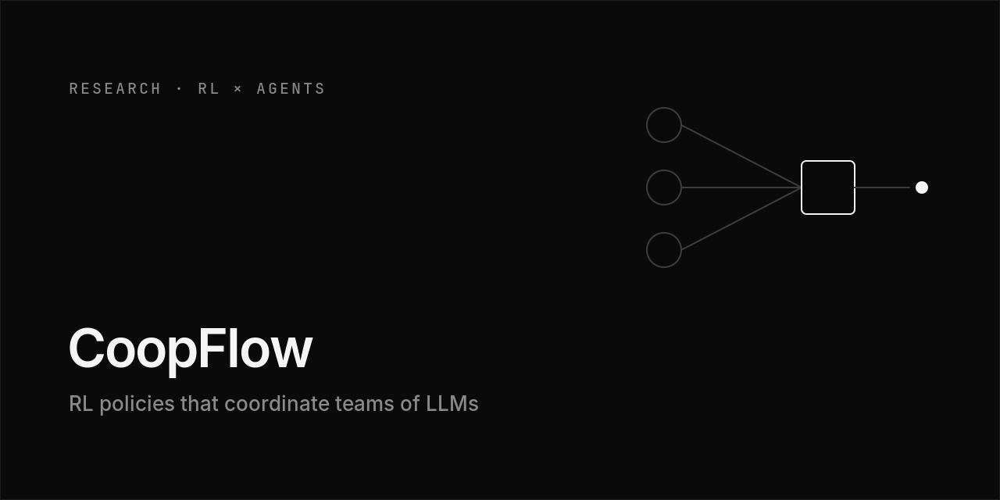
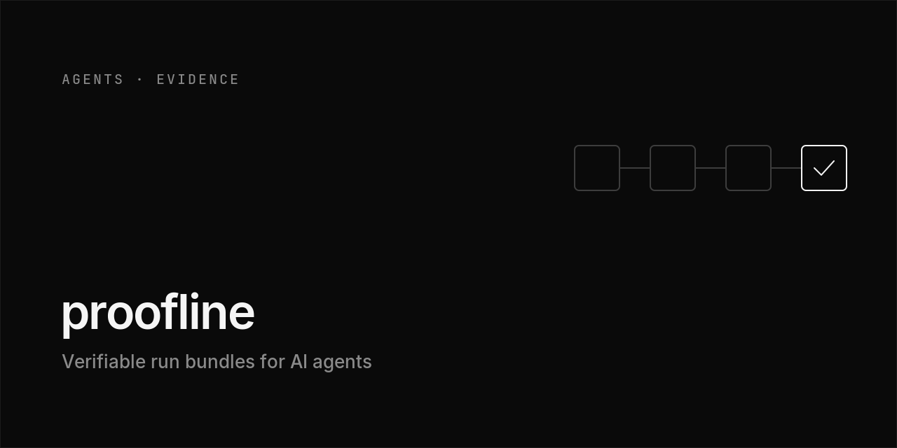
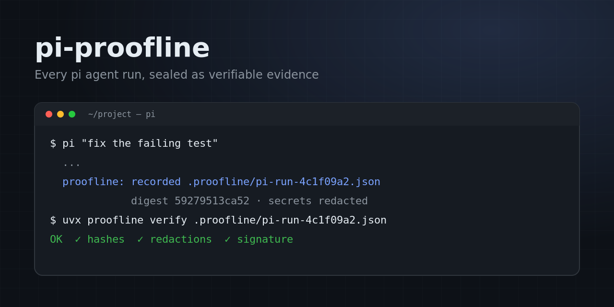
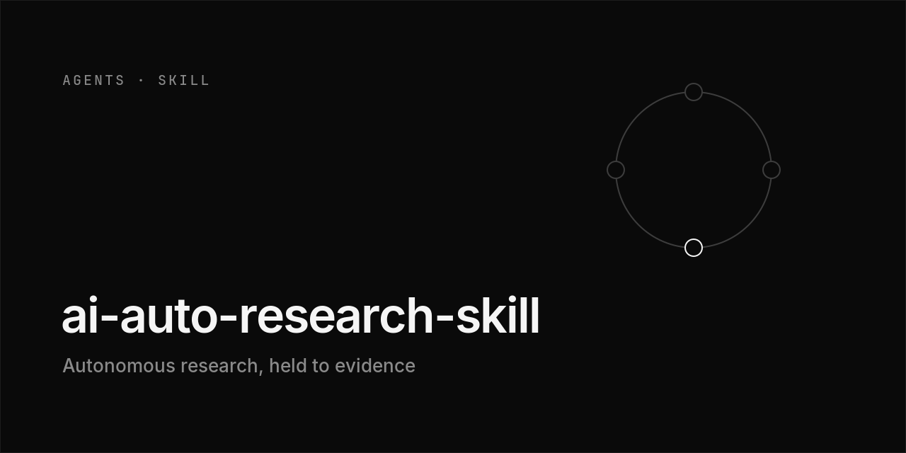
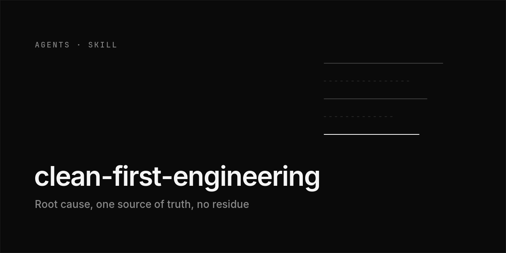
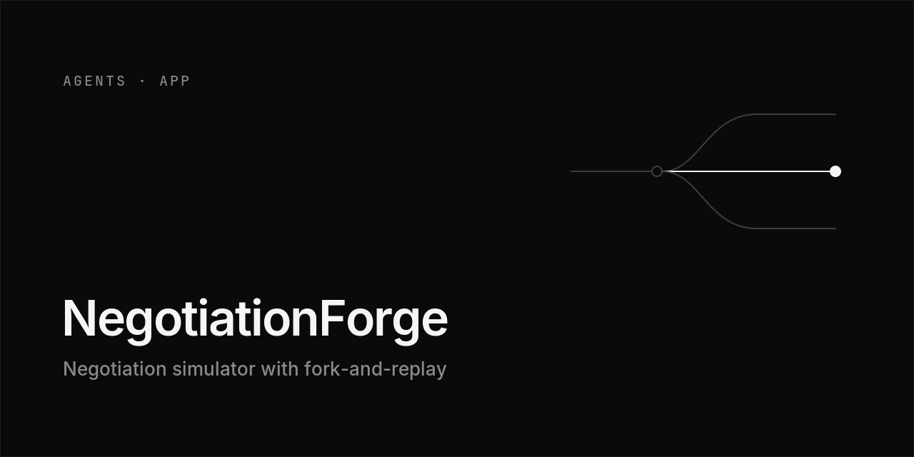
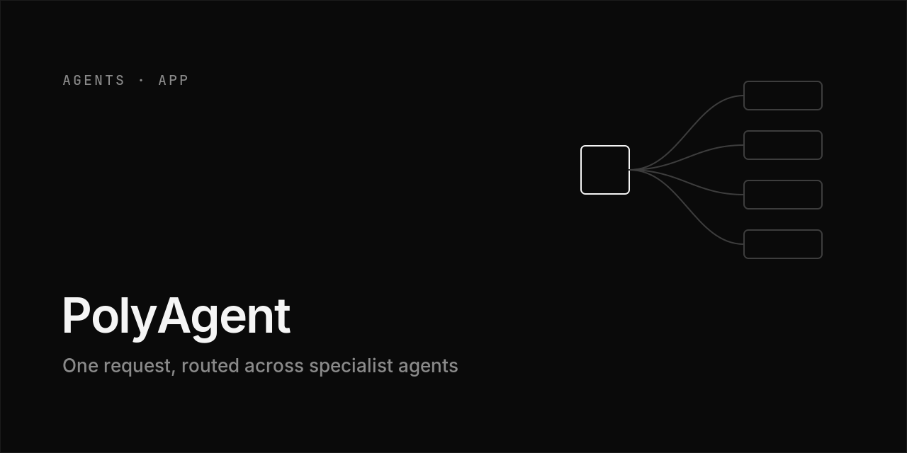

 

AI undergrad working in two directions: **reinforcement learning**, and **AI agents** that leave verifiable evidence of what they did.

 

### Reinforcement Learning

<table>
  <tr>
    <td width="50%" valign="top">
      
       Bilingual textbook, bandits to GRPO. Each chapter removes one mechanism and shows the failure. <a href="https://powfu-zwx.github.io/BreakRL/">Read online</a>
    </td>
    <td width="50%" valign="top">
      
       An RL controller decides when frozen local LLMs execute, review, repair or stop, under a token budget. Scored by execution on BIRD text-to-SQL.
    </td>
  </tr>
</table>

### AI Agents

<table>
  <tr>
    <td width="50%" valign="top">
      
       One JSON bundle per run: hashed, redacted, signable, diffable in CI. <code>pip install proofline</code>
    </td>
    <td width="50%" valign="top">
      
       Records every pi coding-agent run as a verifiable proofline bundle. <code>pi install npm:pi-proofline</code>
    </td>
  </tr>
  <tr>
    <td width="50%" valign="top">
      
       Agent skill for autonomous research: bounded experiments, independent evaluation, strategy reviews.
    </td>
    <td width="50%" valign="top">
      
       Agent skill for clean code: fix the root cause, keep one source of truth, leave no residue.
    </td>
  </tr>
  <tr>
    <td width="50%" valign="top">
      
       AI opponent with tracked hidden state, per-turn analysis, and fork-and-replay from any turn.
    </td>
    <td width="50%" valign="top">
      
       Multi-agent workspace for grounded QA, summaries, formal writing and guided tasks.
    </td>
  </tr>
</table>

 

Python · PyTorch · TypeScript
