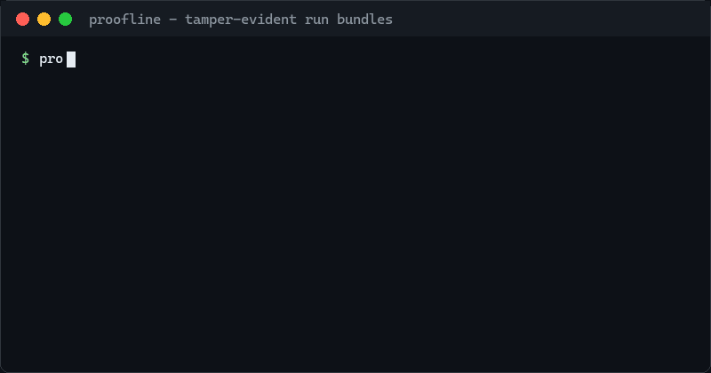

<p align="center">
  
</p>

<p align="center">
  <a href="https://pypi.org/project/proofline/"></a>
  <a href="https://www.npmjs.com/package/pi-proofline"></a>
  <a href="https://powfu-zwx.github.io/BreakRL/"></a>
  
</p>

I study AI as an undergrad and spend most of my time on reinforcement learning and AI agents.
The thread running through my projects: **an agent's claim is only as good as the evidence behind it.**
So I build tools that record what a run actually did, research that is scored by real execution, and a textbook that teaches algorithms by breaking them.

<br>

## ▍Now building · proofline

<a href="https://github.com/Powfu-zwx/proofline">
  
</a>

Every LLM or agent run becomes one JSON bundle: inputs, code revision, model and tool steps, outputs, costs, redactions and hashes.

<table>
  <tr>
    <td width="33%" valign="top"><b>Verify</b><br><sub>Re-check every hash, redaction and secret pattern offline. Ed25519 signing for bundles nobody can quietly re-seal.</sub></td>
    <td width="33%" valign="top"><b>Diff</b><br><sub>Semantic diffs that ignore run ids and timestamps, so a CI gate fails only when inputs, outputs or costs really changed.</sub></td>
    <td width="33%" valign="top"><b>Replay</b><br><sub>Serve recorded responses back through the wrappers: deterministic, offline, free re-runs that separate your bug from model drift.</sub></td>
  </tr>
</table>

```bash
pip install proofline                 # Python SDK + CLI
pi install npm:pi-proofline           # record every pi coding-agent run
```

<br>

## ▍Research

<table>
  <tr>
    <td width="50%" valign="top">
      <a href="https://github.com/Powfu-zwx/CoopFlow"></a>
      <h3><a href="https://github.com/Powfu-zwx/CoopFlow">CoopFlow</a></h3>
      A small RL policy decides when a team of frozen local LLMs should execute, review, repair or stop, under a hard token budget. Every answer is scored by running it on real SQLite databases (BIRD text-to-SQL), with no LLM judges.
      <br><sub>Python · PyTorch · PPO · counterfactual credit</sub>
    </td>
    <td width="50%" valign="top">
      <a href="https://github.com/Powfu-zwx/BreakRL"></a>
      <h3><a href="https://github.com/Powfu-zwx/BreakRL">BreakRL</a></h3>
      A bilingual RL textbook in 14 chapters, from bandits to GRPO. Each chapter explains an algorithm, then removes one key mechanism so you can watch it fail. Every chapter opens in Colab.
      <br><sub><a href="https://powfu-zwx.github.io/BreakRL/">Read online</a> · English / 中文 · Jupyter Book</sub>
    </td>
  </tr>
</table>

## ▍Tools & skills for coding agents

<table>
  <tr>
    <td width="33%" valign="top">
      <a href="https://github.com/Powfu-zwx/pi-proofline"></a>
      <h3><a href="https://github.com/Powfu-zwx/pi-proofline">pi-proofline</a></h3>
      <sub>Extension for the pi coding agent. Each prompt becomes a sealed proofline bundle captured at the provider boundary. One TypeScript file, zero runtime deps.</sub>
    </td>
    <td width="33%" valign="top">
      <a href="https://github.com/Powfu-zwx/ai-auto-research-skill"></a>
      <h3><a href="https://github.com/Powfu-zwx/ai-auto-research-skill">ai-auto-research-skill</a></h3>
      <sub>Autonomous research loop: every claim needs a bounded experiment and an independent evaluator before the agent moves on.</sub>
    </td>
    <td width="33%" valign="top">
      <a href="https://github.com/Powfu-zwx/clean-first-engineering"></a>
      <h3><a href="https://github.com/Powfu-zwx/clean-first-engineering">clean-first-engineering</a></h3>
      <sub>Engineering discipline as an agent skill, in English and Chinese: fix the root cause, one source of truth, leave no residue.</sub>
    </td>
  </tr>
</table>

## ▍Apps

<table>
  <tr>
    <td width="50%" valign="top">
      <a href="https://github.com/Powfu-zwx/NegotiationForge"></a>
      <h3><a href="https://github.com/Powfu-zwx/NegotiationForge">NegotiationForge</a></h3>
      Local-first negotiation simulator. The AI opponent has tracked hidden state, every turn gets analysed, and you can fork any turn to replay a different strategy.
      <br><sub>Next.js 15 · FastAPI · SQLite · DeepSeek / OpenAI / Gemini</sub>
    </td>
    <td width="50%" valign="top">
      <a href="https://github.com/Powfu-zwx/PolyAgent"></a>
      <h3><a href="https://github.com/Powfu-zwx/PolyAgent">PolyAgent</a></h3>
      Multi-agent workspace that routes one request across grounded QA, document summaries, formal writing and step-by-step guidance.
      <br><sub>LangGraph · RAG · Gradio · OpenAI-compatible APIs</sub>
    </td>
  </tr>
</table>

<br>

## ▍Toolbox

<p>
  
</p>

<br>

<p align="center"><sub>Ablation note: remove the unit tests and I become confident and wrong.</sub></p>
