<p align="center">
  
</p>

<p align="center">
  <sub>AI undergrad · reinforcement learning · building tools that leave evidence behind</sub>
</p>

```yaml
# current_run.yaml
agent:       powfu
objective:   understand things by breaking them on purpose
reward:      evidence > vibes
training_on: [reinforcement-learning, coding-agents, verifiable-evals]
status:      still exploring (ε = 0.3)
```

### ▍episodes

| | project | hypothesis |
|:--:|:--|:--|
| `ep.01` | **[BreakRL](https://github.com/Powfu-zwx/BreakRL)** | You only understand an algorithm once you can predict how it fails. A bilingual RL textbook where every chapter ablates a key mechanism and lets you watch it break. |
| `ep.02` | **[ai-auto-research-skill](https://github.com/Powfu-zwx/ai-auto-research-skill)** | Autonomous research is only worth trusting when every claim has a bounded experiment and an independent evaluator behind it. |
| `ep.03` | **[clean-first-engineering](https://github.com/Powfu-zwx/clean-first-engineering)** | Agents write better code under the same discipline good engineers keep: fix the root cause, one source of truth, no residue. |

### ▍ablation study: me

| removed component | observed behaviour |
|:--|:--|
| coffee | reward → 0, loss → ∞ |
| deadlines | never converges |
| unit tests | confident and wrong |
| **evidence** | **vibes. only vibes.** |

<p align="right"><sub><code>run complete · exit 0</code></sub></p>
